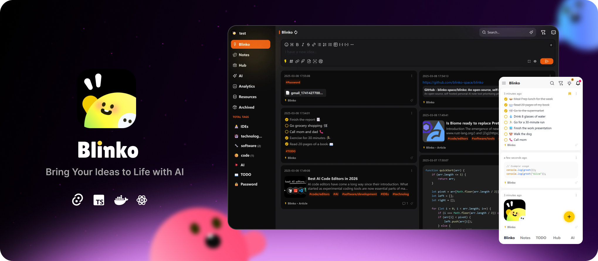

<p align="center">
  
</p>

<h1 align="center">Ink</h1>

<p align="center">
  <strong>Ideas · Notes · Tasks · AI workflows</strong><br/>
  A self-hosted notebook for personal creators — capture ideas, write long-form notes, manage todos, and run AI workflows.<br/>
  Your data stays on your machine, where it belongs.
</p>

<p align="center">
  <a href="https://ink.baispace.cn">Live Demo</a> ·
  <a href="#-quick-start">Quick Start</a> ·
  <a href="#-architecture">Architecture</a> ·
  <a href="#-ai--mcp">AI / MCP</a> ·
  <a href="./README.zh-CN.md">简体中文</a>
</p>

---

## ✨ Features

### 📝 Three Record Types

| Type | Use Case | Highlights |
|---|---|---|
| **Idea (闪念)** | Fleeting thoughts, quick capture | Modal-style minimal input, full keyboard flow, `#tag` / `@mention` |
| **Note** | Long-form, tutorials, deep thinking | Markdown rich text (Tiptap), attachments, mentions, bidirectional links, version history |
| **Todo** | Tasks, plans | Date + priority, keyboard-driven check / sort / filter |

### 🗂️ Organization & Review

- **Hierarchical tags**: parent-child nesting (`#work/projects/ink`)
- **Bidirectional mentions**: `@` to reference notes, auto-aggregated "referenced by"
- **Attachments**: images, files, browsable per-note or globally
- **Sharing**: public links (password / expiry / view limit) + internal share
- **Random review**: time-windowed "review a few today" prompts
- **Archive / Recycle bin**: soft delete + one-click purge
- **Publish**: turn a note into an independent public page (`/share/...`)

### 🤖 AI

- **Multi-provider**: OpenAI / Anthropic / Google / Azure / Ollama / OpenAI-compatible
- **AI chat**: streaming output, abortable, cite-back to source notes
- **RAG**: embedding-based semantic search
- **AI workflows**:
  - **daily**: auto-summarize today's records + todos into a daily note
  - **weekly / practice**: weekly review / practice quizzes (extensible)
- **Scheduled tasks** (pg-boss): cron scheduling + task history
- **External AI conversation import**: idempotent `importConversation` API to pull full ChatGPT / Claude / etc. conversation records (role, model, timestamps, metadata) into Ink

### 🧩 Personalization

- **Site brand**: customizable site name, tagline, logo (live in DB, change via Settings)
- **Theme**: light / dark / follow-system + 8 preset accent colors (CSS variable driven)
- **Workspace dropdown**: 3 built-in system items + configurable internal / external links (Quick Links, up to 12)
- **i18n**: zh-CN / en built-in, framework supports more

### 🔌 MCP (Model Context Protocol)

Expose Ink's note capabilities as **11 MCP tools** — any MCP-compatible AI client (Claude Desktop, Cursor, Cline, etc.) can read and write your notebook directly:

- `searchBlinko` — full-text / tag / time search
- `upsertBlinko` — create or update a note
- `updateBlinko` — partial update
- `deleteBlinko` — delete (with confirmation)
- `createComment` — add a comment to a note
- `webSearch` — web search
- `createScheduledTask` / `listScheduledTasks` / `deleteScheduledTask` — scheduled tasks
- `importConversation` — idempotent external AI conversation import
- `webExtra` — web page extraction

Supports both stdio and HTTP (SSE / Streamable HTTP) transports. Auth via Personal Access Token.

### 🖥️ Multi-platform

- **Web** (Vite + React 18 + HeroUI)
- **Tauri desktop** (macOS / Windows / Linux)
- **Tauri mobile** (Android, iOS experimental)
- **quicknote / quickai / quicktool** — desktop mini-windows via global hotkeys

### 🔒 Data Ownership

- All notes / attachments / config live in your own PostgreSQL
- Attachments on local filesystem (or S3-compatible storage)
- No telemetry, no external dependencies
- Full export / import API

---

## 🚀 Quick Start

### Option 1: Docker Compose (recommended for production)

```bash
# Clone
git clone https://github.com/baispace/blinko.git ink
cd ink

# Copy and edit the env template
cp .env.docker.example .env
# Edit .env — NEXTAUTH_SECRET MUST be a strong random value:
#   openssl rand -base64 32

# One command to launch
docker compose -f docker-compose.prod.yml up -d

# Open
open http://localhost:1111
```

`docker-compose.prod.yml` starts two containers:

- `ink-web` — the Ink app (port 1111)
- `ink-postgres` — PostgreSQL 14 (port 5432, only reachable on the docker network)

On first start, the app automatically runs Prisma migrations and seeds demo data (tags + welcome notes).

### Option 2: Local Development

```bash
# Prerequisites: Node.js ≥ 20, Bun ≥ 1.2.8, PostgreSQL ≥ 14

# 1. Clone
git clone https://github.com/baispace/blinko.git ink
cd ink

# 2. Install deps (monorepo workspaces)
bun install

# 3. Create the `blinko` database and set DATABASE_URL
# 4. Copy env template
cp .env.local.example .env
# Edit .env so DATABASE_URL points to your local PostgreSQL

# 5. Run Prisma migration
bun run prisma:migrate:dev

# 6. Start dev server (Express + Vite combined, port 1111)
bun run dev:backend    # backend only
# or
cd app && bun run dev  # frontend only (Vite)
```

---

## 🏗️ Architecture

```
ink/                          ←  monorepo (Bun workspaces + Turbo)
├── app/                      ←  React 18 + Vite + HeroUI frontend
│   ├── src/
│   │   ├── pages/            ←  routes: home / detail / ai / settings / share / ...
│   │   ├── components/       ←  UI components (Sidebar / Editor / Card / ...)
│   │   ├── store/            ←  MobX stores (blinko / ai / user / config)
│   │   └── lib/i18n.ts
│   ├── src-tauri/            ←  Tauri desktop shell
│   └── tauri-plugin-blinko/  ←  custom Tauri plugin
├── server/                   ←  Node + Express + tRPC backend
│   ├── routerTrpc/           ←  type-safe tRPC routes (note/ai/config/user/...)
│   ├── routerExpress/        ←  Express routes (file upload / MCP / OAuth callback)
│   ├── aiServer/             ←  AI providers + MCP tools + workflow engine
│   └── jobs/                 ←  pg-boss scheduled jobs (auto-archive / embedding rebuild / AI tasks)
├── shared/                   ←  cross-package TS lib (types / zod schemas / utils)
├── blinko-types/             ←  Prisma generated types
├── prisma/                   ←  schema.prisma + migrations + seedfiles
├── dockerfile                ←  multi-stage image build (bun 1.2.8 + arm64 sharp prebuilt)
├── docker-compose.prod.yml   ←  production stack (web + postgres)
└── .env.*.example            ←  environment variable templates
```

**Tech Stack**:

- Frontend: React 18 + TypeScript + Vite + HeroUI + MobX + Tiptap + i18next
- Backend: Node + Express + tRPC + Prisma + pg-boss
- Database: PostgreSQL 14+
- Desktop: Tauri 2.x
- Package manager: Bun ≥ 1.2.8
- Monorepo: Turbo

---

## ⚙️ Configuration

### Key environment variables

Full templates in `.env.local.example` (dev) and `.env.docker.example` (Docker).

| Variable | Description | Required |
|---|---|---|
| `DATABASE_URL` | PostgreSQL connection string | ✅ |
| `NEXTAUTH_URL` | External app URL (with protocol) | ✅ |
| `NEXT_PUBLIC_BASE_URL` | Same, visible to the browser | ✅ |
| `NEXTAUTH_SECRET` | JWT signing secret. **In production MUST be strong random**: `openssl rand -base64 32` | ✅ |
| `NODE_ENV` | `development` / `production` | recommended |

All in-app customization (brand / theme / workspace menu / Quick Links) is configured visually in Settings and stored in DB — no env vars needed.

### Backup

PostgreSQL data + `.blinko/files/` (local attachments) is your full dataset. Recommended:

```bash
# Database
docker exec ink-postgres pg_dump -U postgres postgres > backup.sql

# Attachments (if mounted to host)
tar -czf attachments.tar.gz /path/to/.blinko/files/
```

---

## 🤖 AI & MCP

### Add an AI Provider

Settings → AI Providers → Add:

- **Provider type**: OpenAI / Anthropic / Google / Azure / Ollama / OpenAI-compatible
- **API Key** + **Base URL** (use a custom gateway for compatible interfaces)
- **Model**: add manually or one-click fetch from the provider
- **Capabilities**: toggle chat / embedding / tool use

### Enable MCP servers

Settings → AI → MCP Servers:

- **stdio transport**: local command (e.g. `claude-desktop`) + env / args
- **HTTP transport**: remote MCP server URL + headers (with PAT)

Ink's own MCP server is enabled by default, endpoints:

- HTTP Streamable: `POST /api/mcp` (OAuth / PAT auth)
- HTTP SSE: `GET  /api/mcp/sse` (legacy clients)

### External AI conversation import

```bash
curl -X POST http://localhost:1111/api/v1/ai/import \
  -H "Authorization: Bearer $INK_PAT" \
  -H "Content-Type: application/json" \
  -d '{
    "source": "chatgpt",
    "externalId": "conv_abc123",
    "title": "Ink open-source design discussion",
    "model": "gpt-4o",
    "createdAt": "2026-10-15T10:00:00Z",
    "messages": [
      { "externalId": "msg_1", "role": "user", "content": "..." },
      { "externalId": "msg_2", "role": "assistant", "content": "...", "model": "gpt-4o" }
    ]
  }'
```

Idempotency key: `(accountId, externalId)` unique constraint. Re-posting only updates, never duplicates.

---

## 🧩 Personalization

### Site brand

Settings → Site appearance → Site name / tagline / logo:

- `customTitle`: default `Ink`
- `customTagline`: default `闪念 · 笔记 · 待办 · AI 工作流`
- `customIcon`: upload PNG/SVG, live at `/api/file/...`

### Theme

- **Mode**: light / dark / follow-system (Settings → Appearance & language)
- **Accent color**: 8 presets (blue / red / purple / green / orange / pink / forest / teal) — CSS variable `--primary` drives all interactive colors

### Workspace dropdown

Click the site name in the bottom-left corner → dropdown shows:

- 3 built-in system items (Home / Appearance / About)
- Your custom internal links (to Ink routes)
- Your custom external links (to blog / docs / third-party)

Up to 12 Quick Links. Edits sync to all clients immediately.

---

## 🛠️ Development

### Common commands

```bash
bun install                  # install deps (monorepo workspaces)
bun run prisma:generate      # generate Prisma client
bun run prisma:migrate:dev   # run migration (dev mode)
bun run dev                  # Tauri desktop dev
bun run dev:backend          # backend only (Express + Vite combined)
bun run dev:frontend         # frontend only (Vite)
bun run build:web            # web build
bun run prisma:studio        # Prisma Studio for database
bun run test                 # run tests
```

### Debugging tips

- `app/src/store/` MobX stores — observe with React DevTools + mobx-devtools
- tRPC requests — use `trpc-client-devtools` browser extension
- Database — Prisma Studio (`bun run prisma:studio`)
- Ad-hoc scripts — `bun -e '...'` one-liners

---

## 🤝 Contributing

PRs welcome. Conventions:

1. **Atomic commits**: one commit, one thing
2. **Commit message**: English `type(scope): subject` (feat / fix / refactor / chore / docs), subject ≤ 72 chars
3. **TypeScript**: CI runs `tsc --noEmit`; new files avoid `any`
4. **Tests**: core business logic must include tests (see `scripts/tests/`)
5. **No secrets**: tokens / passwords / user data are never committed
6. **Before PR**: run the dev server locally to confirm no regression

When opening an issue, please include:

- Ink version (`git rev-parse HEAD`)
- OS / Node / Bun / Postgres versions
- Repro steps / screenshot / key logs

---

## 🪪 License

[MIT](./LICENSE) — free to use, modify, and ship commercially. Keep the copyright notice.

---

## 🙏 Acknowledgements

- Second-source release based on [Blinko](https://github.com/blinko-space/blinko)
- UI framework [HeroUI](https://heroui.com/)
- Editor [Tiptap](https://tiptap.dev/)
- AI SDK [Mastra](https://mastra.ai/) / [Vercel AI SDK](https://sdk.vercel.ai/)
- Background jobs [pg-boss](https://github.com/timgit/pg-boss)
- State management [MobX](https://mobx.js.org/)
- Desktop shell [Tauri](https://tauri.app/)

<p align="center">
  Made with 🖋 by <a href="https://baispace.cn">baispace</a>
</p>
